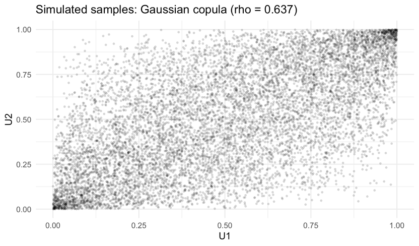
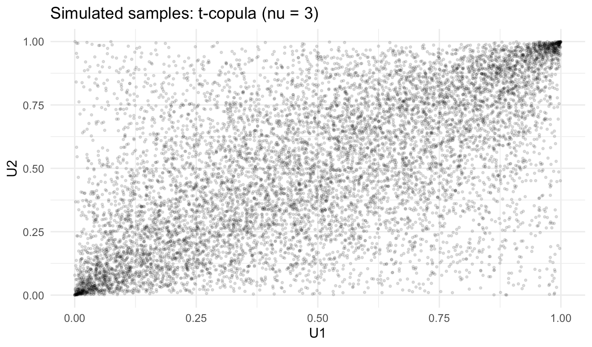
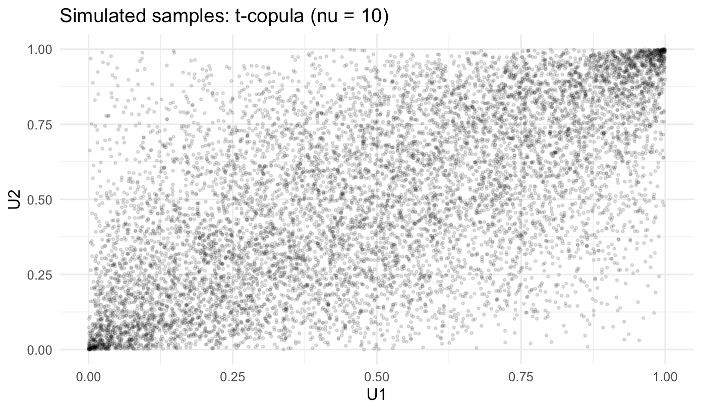
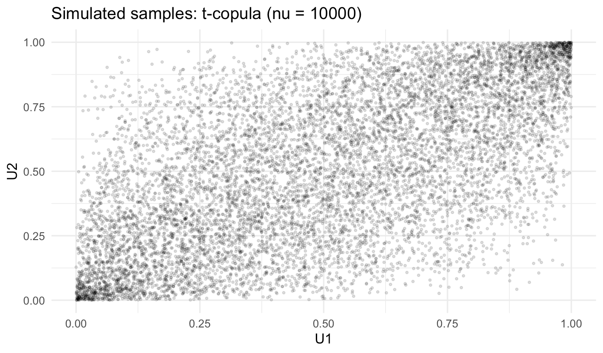
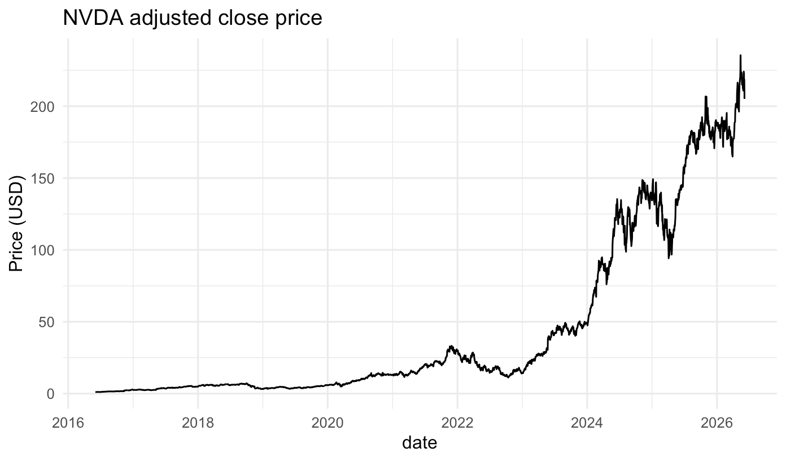
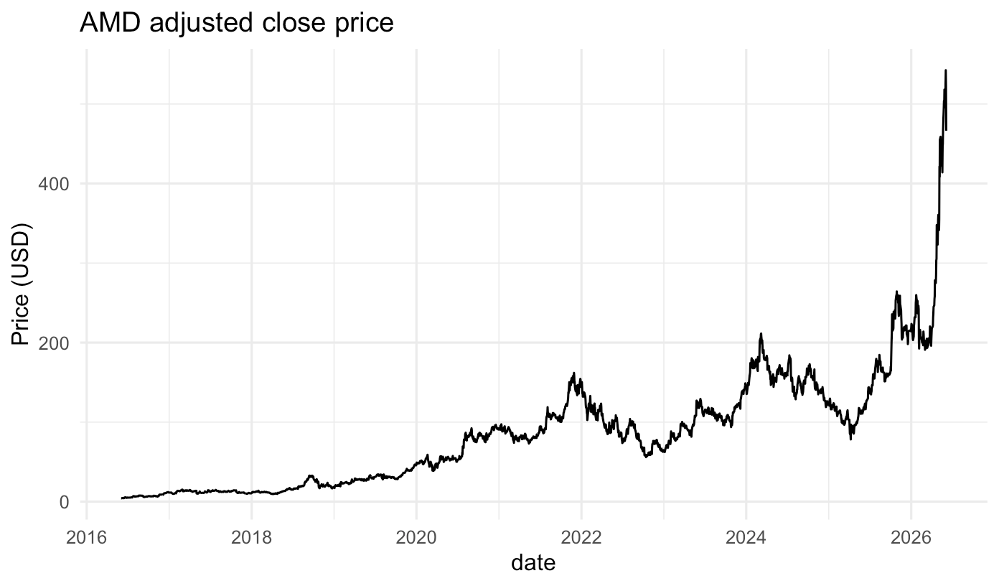
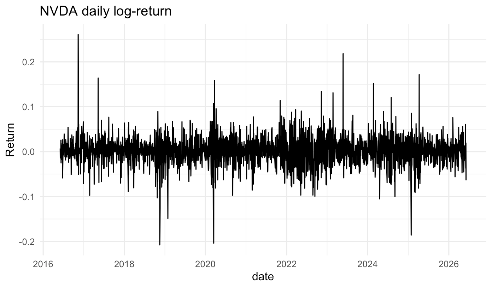
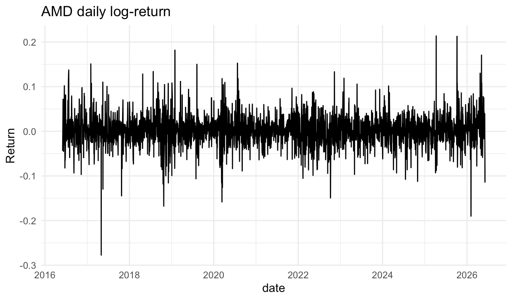
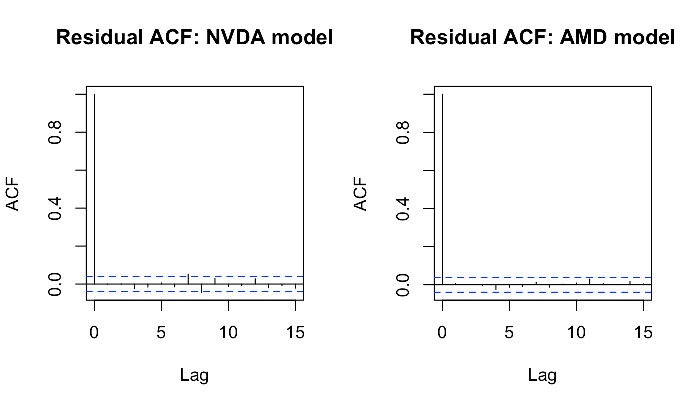
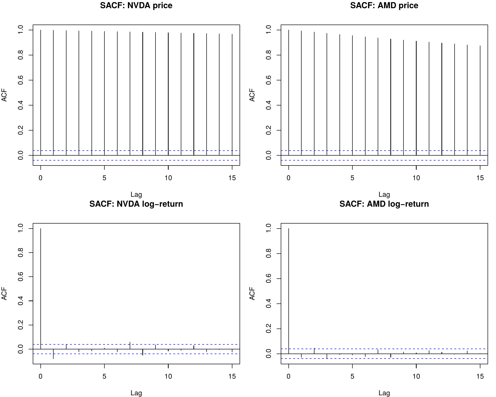

# Copula-Based Tail Risk & Time Series Analysis of NVIDIA (NVDA) and AMD


**Author:** Corinne C.
**Course:** ACTL3301/5301 – Models for Risk Management, UNSW Sydney (Term 2, 2026)

---

## Overview

When two stocks move together, the risk of holding both is not simply the sum of their individual risks – it depends on **how they behave together in a crisis**. This project takes two of the most closely linked semiconductor stocks, **NVIDIA (NVDA)** and **AMD**, and asks:

1. **How much does the dependence structure matter for portfolio tail risk?** I build an equally weighted \$1 portfolio and estimate Value-at-Risk (VaR) and Expected Shortfall (ES) using a range of copula models (independence, Gaussian, Student-t, comonotonic/countermonotonic bounds and a best-fit Archimedean copula), benchmarked against the empirical joint distribution.
2. **Are the daily returns themselves predictable?** I test for stationarity, fit MA(3) models by method of moments, compare them with `auto.arima`, run a manual Box–Jenkins 5-day-ahead forecast and check the residuals.

All analysis is done in **R**, using ten years of daily adjusted closing prices from Yahoo Finance (1 June 2016 – 5 June 2026).

### Key findings

- **AMD carries more standalone tail risk than NVDA** at every confidence level (e.g. 99% VaR of 8.90% vs 7.67%).
- **The two stocks are strongly dependent** (Kendall's τ = 0.487, Spearman's ρ = 0.661). Assuming independence understates the portfolio's 99% VaR by roughly 28% (5.67% vs an empirical 7.85%).
- **Gaussian and t-copulas track the empirical portfolio VaR closely.** Low-degrees-of-freedom t-copulas add visible joint-tail clustering that the Gaussian copula cannot produce.
- **The best Archimedean fit (BB1) shows strongly asymmetric tail dependence:** upper (joint-loss) tail λ<sub>U</sub> ≈ 0.53 vs lower (joint-gain) tail λ<sub>L</sub> ≈ 0.07. NVDA and AMD are much more likely to crash together than to rally together – but BB1 overstates the empirically observed joint-crash frequency.
- **Prices are non-stationary; log-returns are stationary and close to white noise.** ARMA forecasts for the following 5 trading days collapse to the unconditional mean, consistent with weak-form market efficiency.

---

## Contents

- [Repository structure](#repository-structure)
- [Data and methodology](#data-and-methodology)
- [Part 1 – Copula-based tail risk](#part-1--copula-based-tail-risk)
  - [1.1 Individual stock tail risk](#11-individual-stock-tail-risk)
  - [1.2 Dependence measures](#12-dependence-measures)
  - [1.3 Independence copula](#13-independence-copula)
  - [1.4 Gaussian copula](#14-gaussian-copula)
  - [1.5 Student-t copulas](#15-student-t-copulas)
  - [1.6 Comonotonicity and countermonotonicity](#16-comonotonicity-and-countermonotonicity)
  - [1.7 Model comparison vs empirical benchmark](#17-model-comparison-vs-empirical-benchmark)
  - [1.8 Best-fitting Archimedean copula](#18-best-fitting-archimedean-copula)
- [Part 2 – Time series analysis](#part-2--time-series-analysis)
  - [2.1 Stationarity](#21-stationarity)
  - [2.2 MA(3) by method of moments](#22-ma3-by-method-of-moments)
  - [2.3 auto.arima model selection](#23-autoarima-model-selection)
  - [2.4 Five-day-ahead forecast](#24-five-day-ahead-forecast)
  - [2.5 Residual diagnostics](#25-residual-diagnostics)
- [Conclusion](#conclusion)
- [How to reproduce](#how-to-reproduce)
- [Notes and limitations](#notes-and-limitations)
- [Academic integrity note](#academic-integrity-note)

---

## Repository structure

```
.
├── README.md
├── R/
│   └── nvda_amd_copula_timeseries.R   # full analysis script (all tasks)
└── images/                            # figures used in this README
    ├── fig1_gaussian_copula.png
    ├── fig2a_t_copula_nu3.png
    ├── fig2b_t_copula_nu10.png
    ├── fig2c_t_copula_nu10000.png
    ├── fig3a_nvda_price.png
    ├── fig3b_amd_price.png
    ├── fig4a_nvda_log_return.png
    ├── fig4b_amd_log_return.png
    ├── fig5_residual_acf.png
    └── figA1_sacf_grid.png
```

---

## Data and methodology

- **Data:** daily adjusted closing prices for NVDA and AMD from Yahoo Finance (via `quantmod`), 1 June 2016 to 5 June 2026.
- **Log-returns:** $X_t = \ln(P_t / P_{t-1})$.
- **Loss per \$1 invested:** $L_t = 1 - e^{X_t}$. The equally weighted portfolio loss is $L = 0.5\,(L_1 + L_2)$, where $L_1$ is NVDA and $L_2$ is AMD.
- **Simulation settings:** 10,000 simulations per model, `RNGversion("4.3.0")` with `set.seed(2026)` re-issued before every new simulation. Quantile levels $\alpha \in \{0.95,\ 0.99,\ 0.995\}$.
- **Marginals:** all quantile inversions use the empirical distribution of each loss series.
- **Pseudo-observations:** computed as $\text{rank}(x)/(n+1)$ rather than the raw `ecdf()`, so that no value is mapped to exactly 1 at the sample maximum. This avoids instability in copula density and quantile calculations.
- **VaR / ES:** empirical (type-1 quantile, i.e. inverse-ECDF, for consistency with the marginal inversion). ES is the mean of losses at or beyond the VaR threshold.

---

## Part 1 – Copula-based tail risk

### 1.1 Individual stock tail risk

VaR$_\alpha$ and ES$_\alpha$ computed from the empirical loss distributions of each stock.

| Stock | α | VaR | ES |
|---|---|---|---|
| NVDA (L1) | 0.95 | 4.57% | 6.74% |
| NVDA (L1) | 0.99 | 7.67% | 10.17% |
| NVDA (L1) | 0.995 | 9.24% | 12.22% |
| AMD (L2) | 0.95 | 5.27% | 7.58% |
| AMD (L2) | 0.99 | 8.90% | 11.52% |
| AMD (L2) | 0.995 | 10.62% | 13.65% |

AMD has larger VaR and ES than NVDA at every confidence level, so despite NVDA's much larger cumulative price appreciation, AMD has the heavier standalone tail risk. The gap between ES and VaR is similar for both stocks and widens as α increases, meaning losses beyond the quantile are material for both. Neither measure says anything about whether extreme losses *occur together*, which motivates the copula analysis below.

### 1.2 Dependence measures

Kendall's τ is computed directly from the number of concordant and discordant pairs, $\tau = (n_c - n_d)/\binom{n}{2}$. Spearman's ρ is the Pearson correlation of the rank-based pseudo-observations of $L_1$ and $L_2$.

| Measure | Value |
|---|---|
| Kendall's τ (direct pairwise count) | 0.487 |
| Spearman's ρ (empirical / rank-based) | 0.661 |

There is a strong positive association between the two stocks, consistent with shared sector exposure (both are semiconductor companies facing similar supply and demand shocks). Because there are no exact ties in the daily log-return data, the direct-count τ coincides with the standard τ-a definition with the total-pairs denominator.

### 1.3 Independence copula

$U_1, U_2$ are simulated as independent Uniform(0,1) samples and mapped through each stock's empirical marginal quantile function.

| α | VaR | ES |
|---|---|---|
| 0.95 | 3.46% | 4.92% |
| 0.99 | 5.67% | 7.57% |
| 0.995 | 6.95% | 8.94% |

This model gives the smallest VaR/ES of all models considered (see [1.7](#17-model-comparison-vs-empirical-benchmark)). Ignoring the true positive dependence understates the probability of large simultaneous losses.

### 1.4 Gaussian copula

The correlation parameter is estimated as the sample Pearson correlation of the log-returns, $\hat\rho = 0.637$. Bivariate normal samples are generated by linear combination (the Cholesky-equivalent method) and transformed with $\Phi$ to obtain uniform margins.

<p align="center">
  
  <br><em>Figure 1. Simulated samples from the fitted Gaussian copula (ρ̂ = 0.637).</em>
</p>

| α | VaR | ES |
|---|---|---|
| 0.95 | 4.58% | 6.59% |
| 0.99 | 7.59% | 9.90% |
| 0.995 | 9.15% | 11.60% |

The scatter plot is elliptical and denser along the diagonal, reflecting positive dependence, but there is no extra clustering in the (0,0) and (1,1) corners. This is expected: the bivariate Gaussian copula has **zero asymptotic tail dependence** for any |ρ| < 1.

### 1.5 Student-t copulas

t-copulas with ν = 3, 10 and 10,000 (and the same $\hat\rho$) are simulated as $Z/\sqrt{\chi^2_\nu/\nu}$ and transformed through the univariate $t_\nu$ CDF.

<table>
  <tr>
    <td align="center" width="50%">
      <br>
      <em>Figure 2a. t-copula, ν = 3.</em>
    </td>
    <td align="center" width="50%">
      <br>
      <em>Figure 2b. t-copula, ν = 10.</em>
    </td>
  </tr>
  <tr>
    <td align="center" colspan="2">
      <br>
      <em>Figure 2c. t-copula, ν = 10,000 – visually indistinguishable from the Gaussian copula (Figure 1).</em>
    </td>
  </tr>
</table>

| ν | α | VaR | ES |
|---|---|---|---|
| 3 | 0.95 | 4.37% | 6.49% |
| 3 | 0.99 | 7.52% | 9.83% |
| 3 | 0.995 | 8.75% | 11.53% |
| 10 | 0.95 | 4.53% | 6.58% |
| 10 | 0.99 | 7.63% | 10.10% |
| 10 | 0.995 | 9.29% | 11.86% |
| 10000 | 0.95 | 4.58% | 6.59% |
| 10000 | 0.99 | 7.65% | 9.91% |
| 10000 | 0.995 | 8.92% | 11.63% |

As ν → ∞ the t-copula converges to the Gaussian copula; this is visible both in Figure 2c vs Figure 1 and in the near-identical VaR/ES values at ν = 10,000 and in the Gaussian case. At low ν (e.g. ν = 3) there is a visibly higher density of points in both the upper-right (1,1) and lower-left (0,0) corners – the symmetric tail dependence characteristic of the t-copula. A Gaussian copula at the same $\hat\rho$ would therefore underestimate the likelihood of simultaneous extreme losses.

### 1.6 Comonotonicity and countermonotonicity

The comonotonic copula uses $U_1 = U_2 = U$ with $U \sim \text{Uniform}(0,1)$; the countermonotonic copula uses $U_2 = 1 - U_1$.

| Copula | α | VaR | ES |
|---|---|---|---|
| Comonotonicity | 0.95 | 4.86% | 7.08% |
| Comonotonicity | 0.99 | 8.33% | 10.71% |
| Comonotonicity | 0.995 | 10.07% | 12.62% |
| Countermonotonicity | 0.95 | 0.05% | 0.21% |
| Countermonotonicity | 0.99 | 0.32% | 0.44% |
| Countermonotonicity | 0.995 | 0.44% | 0.47% |

These are the Fréchet–Hoeffding upper and lower bounds for any copula with the same marginals. Comonotonicity is the worst case (perfect positive dependence, no diversification benefit); countermonotonicity is the best case (a perfect hedge, maximum diversification). All other copulas in this project should fall between these two extremes.

### 1.7 Model comparison vs empirical benchmark

The empirical benchmark uses the true paired sample $(L_1, L_2)$ directly – no simulation.

| Model | VaR (α = 0.95) | VaR (α = 0.99) | VaR (α = 0.995) |
|---|---|---|---|
| **Empirical** | **4.63%** | **7.85%** | **9.33%** |
| Independence | 3.46% | 5.67% | 6.95% |
| Gaussian | 4.58% | 7.59% | 9.15% |
| t (ν = 3) | 4.37% | 7.52% | 8.75% |
| t (ν = 10) | 4.53% | 7.63% | 9.29% |
| Comonotone | 4.86% | 8.33% | 10.07% |

At every α the Gaussian and t-copulas fit the empirical VaR better than the independence copula (which understates tail risk) and the comonotone bound (which overstates it). No single elliptical copula wins at all three levels: the Gaussian is closest at α = 0.95, the ν = 10 and ν = 10,000 t-copulas are closest at α = 0.99, and the ν = 10 t-copula is closest at α = 0.995. The ν = 3 t-copula is the furthest from the empirical VaR at the two higher levels, so a very heavy-tailed t is not obviously better here.

#### Conditional joint-crash probability

The conditional probability $P\big(F_1(X_1) \le 1-\alpha \mid F_2(X_2) \le 1-\alpha\big)$ measures how likely NVDA is to crash given that AMD has crashed. Since $L = 1 - e^{X}$ is strictly decreasing in $X$, this is the same as $P(U_{L_1} \ge \alpha \mid U_{L_2} \ge \alpha)$ on the loss pseudo-observation scale and is estimated as $\hat P(U_{L_1} \ge \alpha,\ U_{L_2} \ge \alpha)\,/\,(1-\alpha)$. Because the independence, Gaussian, t, comonotone and countermonotone copulas are radially symmetric, upper- and lower-tail conventions give the same answer; only the empirical row can differ.

| α | Empirical | Indep. | Gaussian | t (ν=3) | t (ν=10) | t (ν=10000) | Comonot. | Countermon. |
|---|---|---|---|---|---|---|---|---|
| 0.95 | 0.485 | 0.036 | 0.402 | 0.494 | 0.414 | 0.406 | 0.974* | 0.000 |
| 0.99 | 0.318 | 0.020 | 0.210 | 0.360 | 0.370 | 0.220 | 1.020* | 0.000 |
| 0.995 | 0.159 | 0.000 | 0.220 | 0.380 | 0.280 | 0.220 | 1.040* | 0.000 |

\*Comonotone values slightly above 1 are Monte Carlo noise from a small tail sample (n = 10,000 gives only ~50–500 simulated points beyond the 0.99/0.995 thresholds); the true value is exactly 1.

- At α = 0.95 the empirical crash probability (0.485) is much closer to the t(ν=3) copula (0.494) than to the Gaussian (0.402) or independence (0.036). The data therefore contain tail dependence that the Gaussian copula underestimates and independence ignores entirely.
- At α = 0.99 the empirical value (0.318) lies between the Gaussian (0.210) and the low-ν t-copulas (0.360–0.370), again favouring the t-family.
- At α = 0.995 the empirical estimate rests on only ~12–13 joint exceedances and is very noisy; the apparent agreement between the Gaussian and t(ν=10000) values (both 0.220) should not be over-interpreted.

Overall, the t-copula gives the best trade-off between matching VaR/ES and matching joint-crash behaviour – a typical feature of equity pairs with heavy tails and tail dependence. Independence and the comonotone/countermonotone copulas serve mainly as benchmarks.

### 1.8 Best-fitting Archimedean copula

`BiCopSelect` (package `VineCopula`) was used to pick the best-fitting copula by AIC among the **Archimedean families** (Clayton, Gumbel, Frank, Joe, BB1, BB6, BB7, BB8 – family codes 3–10), as required by the brief.

| Quantity | Value |
|---|---|
| Selected family | **BB1** (family code 7) |
| Parameters | θ = 0.143, δ = 1.791 |
| Kendall's τ implied by fit | 0.479 (empirical = 0.487) |
| AIC / BIC | −1632.59 / −1620.93 |
| Upper tail dependence λ<sub>U</sub> | 0.527 |
| Lower tail dependence λ<sub>L</sub> | 0.066 |

BB1 achieved the lowest AIC (−1632.59) of the eight families, and this is also lower than the AIC reported for the t-copula (−1597.10), so a two-parameter Archimedean copula with *asymmetric* tails fits better than the symmetric t-copula by this criterion.

**Interpretation.** BB1 has two parameters and nests Clayton (lower-tail dependence) and Gumbel (upper-tail dependence) as special/limiting cases, so the two tails can differ. On the loss scale used here, λ<sub>U</sub> is the probability that both stocks suffer extreme losses together, and λ<sub>L</sub> is the probability that both post extreme gains together. With λ<sub>U</sub> ≈ 0.53 and λ<sub>L</sub> ≈ 0.07, NVDA and AMD are far more likely to lose together than to gain together – consistent with the well-known "correlation breakdown" phenomenon, where equity correlations rise sharply in crises but not in rallies.

Simulated risk measures under the fitted BB1 copula:

| α | VaR | ES | Crash probability |
|---|---|---|---|
| 0.95 | 4.56% | 6.88% | 0.588 |
| 0.99 | 7.94% | 10.76% | 0.630 |
| 0.995 | 9.74% | 12.82% | 0.560 |

- At α = 0.99 the BB1 VaR (7.94%) is closer to the empirical VaR (7.85%) than any Gaussian or t-copula estimate. At α = 0.995 it overshoots (9.74% vs 9.33%), and the t(ν=10) copula (9.29%) is closer.
- BB1 produces the highest ES of all the non-comonotone models. Its ES at α = 0.99 and 0.995 marginally exceeds the comonotone ES, which is not possible in theory for a coherent risk measure; the difference is within Monte Carlo error for ~50–100 tail points per simulation.
- BB1's implied crash probabilities (0.56–0.63) are well above the empirical values (0.16–0.49) at every α. So although λ<sub>U</sub> is directionally right, it likely implies stronger joint-crash clustering than this ten-year sample shows. AIC is dominated by the bulk of the distribution rather than the extreme tail, where only a handful of joint extreme observations are available to pin down λ<sub>U</sub>.

---

## Part 2 – Time series analysis

### 2.1 Stationarity

Adjusted closing prices and log-returns were plotted and examined using the sample ACF (SACF, 15 lags) and the Augmented Dickey–Fuller (ADF) test.

<table>
  <tr>
    <td align="center" width="50%">
      <br>
      <em>Figure 3a. NVDA adjusted close price.</em>
    </td>
    <td align="center" width="50%">
      <br>
      <em>Figure 3b. AMD adjusted close price.</em>
    </td>
  </tr>
  <tr>
    <td align="center">
      <br>
      <em>Figure 4a. NVDA daily log-return.</em>
    </td>
    <td align="center">
      <br>
      <em>Figure 4b. AMD daily log-return.</em>
    </td>
  </tr>
</table>

| Series | ADF statistic | p-value | Conclusion |
|---|---|---|---|
| NVDA price | −0.357 | 0.988 | Fail to reject unit root – non-stationary |
| AMD price | −0.215 | 0.990 | Fail to reject unit root – non-stationary |
| NVDA return (X1) | −13.53 | 0.01 | Reject unit root – stationary |
| AMD return (X2) | −12.82 | 0.01 | Reject unit root – stationary |

*(ADF p-values of 0.01 are the lower print limit in `tseries::adf.test`, i.e. p ≤ 0.01.)*

Prices show a strong upward trend and a very slowly decaying SACF, and the ADF test cannot reject a unit root. Log-returns show volatility clustering around zero but no trend, their SACFs fall inside the ±1.96/√n bounds after a few lags, and the ADF test rejects a unit root at the 1% level. Log-returns are therefore treated as (weakly) stationary for the rest of the analysis. The full SACF grid is in [Figure A1](#appendix-sacf-grid).

### 2.2 MA(3) by method of moments

For $X_t = \mu + Z_t + \theta_1 Z_{t-1} + \theta_2 Z_{t-2} + \theta_3 Z_{t-3}$, the moment equations linking the sample autocorrelations $\hat\rho_1, \hat\rho_2, \hat\rho_3$ to $(\theta_1, \theta_2, \theta_3)$ are solved numerically, keeping only the invertible solution (all roots of $1 + \theta_1 z + \theta_2 z^2 + \theta_3 z^3$ outside the unit circle). $\sigma^2$ is backed out from the sample variance.

| Series | μ̂ | θ̂₁ | θ̂₂ | θ̂₃ | σ̂² |
|---|---|---|---|---|---|
| NVDA (X1) | 0.00206 | −0.0771 | 0.0383 | −0.0229 | 0.000965 |
| AMD (X2) | 0.00185 | −0.0265 | 0.0441 | −0.0410 | 0.001266 |

Fitted models:

- **NVDA:** $X_{1,t} \approx 0.00206 + Z_t - 0.0771\,Z_{t-1} + 0.0383\,Z_{t-2} - 0.0229\,Z_{t-3}$, $Z_t \sim WN(0,\ 0.000965)$
- **AMD:** $X_{2,t} \approx 0.00185 + Z_t - 0.0265\,Z_{t-1} + 0.0441\,Z_{t-2} - 0.0410\,Z_{t-3}$, $Z_t \sim WN(0,\ 0.001266)$

All MA coefficients are small in absolute value, suggesting that daily equity returns are very close to – but not exactly – white noise.

### 2.3 auto.arima model selection

| Series | Selected model | Key coefficients | AIC |
|---|---|---|---|
| NVDA (X1) | ARIMA(0,0,2) with mean | ma1 = −0.0761, ma2 = 0.0374, mean = 0.0021 | −10323.71 |
| AMD (X2) | ARIMA(2,0,2) with mean | ar1 = −1.3593, ar2 = −0.6938, ma1 = 1.3281, ma2 = 0.6940, mean = 0.0018 | −9640.09 |

`auto.arima` chose an MA(2) for NVDA and a mixed ARMA(2,2) for AMD, so the coefficients are not directly comparable with the MA(3) fits above. The estimation approaches also differ: `auto.arima` uses maximum likelihood (a state-space / Kalman-filter representation of the full likelihood), whereas the method-of-moments fit only uses the first three autocorrelations and the sample variance. Moment estimators are fast, map directly onto the SACF through simple algebra, and need no distributional assumption on $Z_t$ beyond finite variance; MLE uses more information from the data.

### 2.4 Five-day-ahead forecast

Forecasts were produced with a **manual Box–Jenkins recursion** (not `predict()`), using the fitted `auto.arima` coefficients and the in-sample residuals as known past innovations, with $E[Z_{T+h}] = 0$ for $h > 0$. Forecasts were compared against the realised log-returns for the five trading days following the sample.

| Day | NVDA predicted | NVDA actual | AMD predicted | AMD actual |
|---|---|---|---|---|
| 1 | 0.74% | 1.92% | 0.52% | −3.63% |
| 2 | −0.03% | −6.40% | −0.24% | −11.50% |
| 3 | 0.21% | 1.71% | 0.52% | 5.01% |
| 4 | 0.21% | −0.22% | 0.02% | −3.07% |
| 5 | 0.21% | −3.80% | 0.18% | −4.98% |

| Series | RMSE | MAE |
|---|---|---|
| NVDA | 3.48% | 2.70% |
| AMD | 6.33% | 5.63% |

Forecasts sit very close to each model's unconditional mean (essentially zero) at every horizon, and predictive power for realised returns is weak to non-existent – for example, AMD fell by over 11% on day 2 while the model forecast was approximately zero. This is expected: daily equity log-returns approximate a martingale difference sequence, so ARMA forecasts collapse to the sample mean after one or two steps. The exercise illustrates the limits of low-order ARMA models for short-horizon equity returns rather than a flaw in the modelling.

### 2.5 Residual diagnostics

If the models are correctly specified, the residuals should behave like white noise. This was tested with the Ljung–Box test up to lag 15.

| Series | X-squared | df | p-value | Conclusion at 5% |
|---|---|---|---|---|
| NVDA residuals | 21.82 | 12 | 0.040 | Reject white noise – some residual autocorrelation remains |
| AMD residuals | 6.88 | 10 | 0.737 | Fail to reject – consistent with white noise |

<p align="center">
  
  <br><em>Figure 5. Residual ACF for the fitted NVDA and AMD models, lags 1–15.</em>
</p>

The AMD residuals look like white noise (p = 0.737), supporting the ARMA(2,2) fit. The NVDA residuals just reject white noise at the 5% level (p = 0.040), with a small spike near lags 7–9 in the residual ACF, so the MA(2) may be slightly misspecified. The effect appears minor: it is significant at 5% but not at 1%, and given the short-horizon forecasting results in 2.4 it is unlikely to matter for forecasting over those timeframes.

---

## Conclusion

**Copulas.** NVDA and AMD are strongly dependent (Kendall's τ ≈ 0.49, Spearman's ρ ≈ 0.66), and this has a material effect on portfolio tail risk: assuming independence significantly understates VaR/ES relative to the empirical benchmark. Elliptical (Gaussian and t) copulas track the empirical tail risk much better, with lower-ν t-copulas capturing the symmetric tail dependence the Gaussian copula misses. The best-fitting Archimedean copula (BB1) improves on the elliptical copulas by AIC and reveals a strong asymmetry – high upper (joint-loss) tail dependence (λ<sub>U</sub> ≈ 0.53) and low lower (joint-gain) tail dependence (λ<sub>L</sub> ≈ 0.07) – that neither the Gaussian nor the t-copula can represent. However, BB1's implied joint-crash probabilities exceed those observed historically, so they are best read as an upper bound.

**Time series.** Log-returns, not prices, should be modelled since only returns are stationary. Method-of-moments MA(3) and AIC-based `auto.arima` fits both describe series that are close to white noise. Five-day-ahead forecasts add little beyond the unconditional mean, in line with what we expect from an efficient market.

---

## How to reproduce

**Requirements:** R (≥ 4.3) and an internet connection (data is downloaded from Yahoo Finance).

```r
# From the repository root
source("R/nvda_amd_copula_timeseries.R")
```

The script installs any missing packages (`quantmod`, `ggplot2`, `tseries`, `forecast`, `VineCopula`), downloads the data, and prints every table above. It also writes `acf_plots.pdf` (the SACF grid) to the working directory.

---

## Notes and limitations

- **Data revisions.** Yahoo Finance adjusted prices are revised retroactively (splits, dividends), so re-running the script later may give slightly different numbers than those shown here.
- **Monte Carlo error.** Tail estimates at α = 0.99 and 0.995 are based on only ~50–100 simulated points out of 10,000, so differences of a few tenths of a percentage point between models should be interpreted cautiously.
- **Small empirical tail sample.** The empirical joint-crash probability at α = 0.995 rests on a dozen or so observations.
- **Forecast evaluation** uses only five out-of-sample days, so the RMSE/MAE figures are illustrative rather than statistically meaningful.

---

## Appendix: SACF grid

<p align="center">
  
  <br><em>Figure A1. Sample ACF (SACF) of NVDA and AMD adjusted close prices and log-returns, lags 1–15.</em>
</p>
